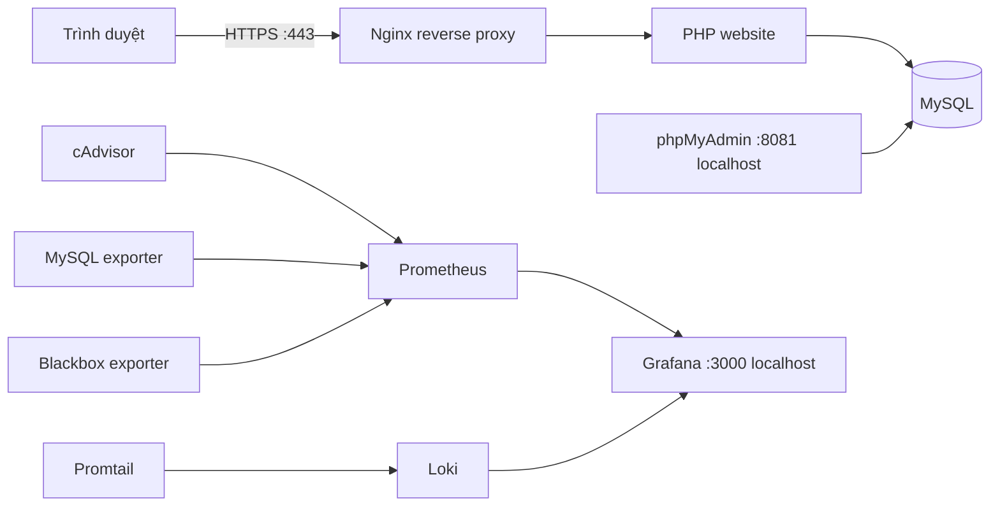

# Đề 25 — Website đăng tin bất động sản

Đồ án môn **Triển khai và Quản trị Hệ thống Phần mềm**. Website Nhà Tốt có dữ liệu nhà, căn hộ, đất nền mẫu; tìm theo từ khóa/khu vực, loại hình và ngân sách; form liên hệ ghi vào MySQL. Toàn bộ stack chạy bằng Docker Compose.

## Kiến trúc



Network Compose tách thành `edge`, `backend` (internal), `admin`, `monitoring` và `logging`. Nginx là đường vào website. phpMyAdmin và dashboard quản trị chỉ bind lên localhost. MySQL không publish cổng lên host.

## Yêu cầu

- Docker Desktop với Docker Compose v2 đang chạy.
- OpenSSL (đã có trong Git for Windows hoặc cài riêng).
- Cổng 80, 443, 3000, 8081, 9090 và 3100 chưa bị chương trình khác chiếm. Các cổng 3000/8081/9090/3100 chỉ bind `127.0.0.1`.
- Đổi tên repository GitHub theo mã số sinh viên trước khi nộp.

## Khởi chạy trên Windows PowerShell

Mở PowerShell tại thư mục repo:

```powershell
Copy-Item .env.example .env
```

Sửa `.env`; thay **tất cả** mật khẩu ví dụ bằng mật khẩu mạnh riêng. File `.env` bị Git bỏ qua. Tạo chứng thư localhost tự ký:

```powershell
openssl req -x509 -nodes -days 365 -newkey rsa:2048 `
  -keyout nginx/ssl/cert.key -out nginx/ssl/cert.crt `
  -subj "/CN=localhost" `
  -addext "subjectAltName=DNS:localhost,IP:127.0.0.1"
```

Chạy toàn bộ stack:

```powershell
docker compose config
docker compose up -d --build
docker compose ps
```

Chờ service `db` healthy. Nếu đây là lần đầu, MySQL tự tạo database/bảng và nạp ba tin mẫu. Tài khoản `bds_app` do Compose tạo chỉ có quyền trên database của website. Script tạo tài khoản `exporter` chỉ đọc một số metadata MySQL cho Prometheus. Dữ liệu tồn tại trong named volume qua lần restart.

| Thành phần | Địa chỉ | Đăng nhập |
|---|---|---|
| Website | `https://localhost` | Không yêu cầu |
| phpMyAdmin | `http://localhost:8081` | `bds_app` và `MYSQL_PASSWORD` trong `.env` |
| Grafana | `http://localhost:3000` | `GRAFANA_USER` và `GRAFANA_PASSWORD` trong `.env` |
| Prometheus | `http://localhost:9090` | Không bật auth; chỉ bind localhost |

Trình duyệt báo chứng thư tự ký chưa được tin cậy; chấp nhận cảnh báo cho demo localhost. Nginx chuyển HTTP sang HTTPS và đặt security headers. Ảnh Unsplash/Google Fonts cần kết nối Internet; chức năng và dữ liệu chính vẫn chạy tại chỗ.

## Chức năng website và database

- Danh sách tin có tiêu đề, ảnh, giá, diện tích, loại hình và địa chỉ.
- Tìm kiếm theo tiêu đề/địa chỉ; lọc loại hình và giá tối đa.
- Gửi liên hệ lưu vào bảng `contacts`; xem bản ghi trong phpMyAdmin.
- Schema/dữ liệu mẫu UTF-8 (`utf8mb4`) ở `mysql/init.sql`; chỉ tự chạy khi khởi tạo volume DB mới.
- PDO prepared statements, encode HTML output, kiểm tra email/độ dài đầu vào, CSRF token.

Để nạp lại schema từ đầu (lệnh này xóa dữ liệu DB demo hiện tại):

```powershell
docker compose down -v
docker compose up -d --build
```

## Giám sát

Datasource Prometheus và Loki được provision sẵn. Dashboard `BDS - System Overview` có container CPU/RAM, MySQL connections/query totals, HTTPS probe Nginx và trạng thái scrape `up`. Prometheus scrape cAdvisor, MySQL exporter và Blackbox exporter; Blackbox probe trang Nginx qua HTTPS. Chờ khoảng 30 giây sau khi stack healthy để có điểm dữ liệu đầu tiên.

Kiểm tra `http://localhost:9090/targets`: các job `prometheus`, `cadvisor`, `mysql`, `nginx`, `blackbox-exporter` cần hiện `UP`. Nếu job MySQL chưa lên, kiểm tra log và exporter password, lưu ý script tạo user chỉ chạy khi volume DB khởi tạo lần đầu.

## Log tập trung và LogQL

Promtail đọc Docker logs, thêm nhãn `service` và `container`, rồi gửi tới Loki. Trong Grafana chọn **Explore → Loki** và chạy:

```logql
{service="nginx"}
{service="web"} |= "Database unavailable"
{service="db"} |~ "ERROR|error|Warning|warning"
```

Gửi một form liên hệ và refresh Explore để có sự kiện mới. Log truy vấn khớp nhãn Compose service (service database là `db`). Nếu chưa thấy log, kiểm tra Promtail/Loki: `docker compose logs promtail loki`.

## Hardening được áp dụng

1. Tiến trình Apache/PHP chạy user `www-data` (non-root), container web drop toàn bộ Linux capabilities; Nginx bật `no-new-privileges`.
2. MySQL ở network `backend` internal, không publish cổng; phpMyAdmin chỉ mở trên loopback máy demo.
3. Web dùng user database riêng, không dùng root; exporter có user/quyền riêng.
4. Mật khẩu cấu hình qua `.env`, `.env` và private key nằm trong `.gitignore`.
5. Nginx ép HTTPS demo, giới hạn TLS từ 1.2, ẩn version, thêm CSP, frame/content/referrer/permissions headers.
6. Dashboard, Prometheus và phpMyAdmin bind localhost; Loki chỉ ở network logging, không publish cổng ra host.

cAdvisor cần đọc một số thông tin host để có container metrics và Promtail cần Docker socket để discover/đọc logs. Hai exporter này có quyền truy cập rộng hơn các dịch vụ ứng dụng; giải thích mục đích và giới hạn việc dùng stack vào môi trường demo/local trong báo cáo. HTTPS tự ký chỉ minh họa cấu hình TLS, không thay thế chứng thư CA cho website public.

## Kiểm tra/demo

1. Mở website, lọc loại hình/khu vực/ngân sách.
2. Gửi lời nhắn hợp lệ; xác nhận có dòng mới trong `batdongsan.contacts` ở phpMyAdmin.
3. Kiểm tra `https://localhost`, redirect HTTP và response headers trong Developer Tools → Network.
4. Kiểm tra Prometheus targets `UP`, mở dashboard Grafana và xác nhận các panel có điểm dữ liệu.
5. Grafana Explore → Loki, chạy ba truy vấn ở trên; phát sinh một request mới nếu cần log.
6. Chụp ảnh các bước trên cùng cấu hình Compose/network, user `www-data`, Nginx headers và grants DB.

Lệnh chẩn đoán hữu ích:

```powershell
docker compose ps
docker compose logs --tail 100 web db nginx prometheus grafana loki promtail
docker compose down
```

## Ba commit theo rubric

Repo được dựng theo ba mốc nội dung. Sau khi cá nhân hóa, tạo ba commit có ý nghĩa (không commit `.env`, private key, hoặc ảnh chứa bí mật):

```text
Commit 1 — feat: deploy property site with mysql and nginx
  app/, mysql/, nginx/, docker-compose.yml, .env.example, .gitignore, README phần khởi chạy
Commit 2 — feat: add prometheus grafana monitoring
  prometheus/, grafana/, thay đổi Compose cho exporters và monitoring
Commit 3 — feat: centralize logs with loki promtail and hardening
  loki/, promtail/, thay đổi Compose/network, README phần LogQL/security/demo
```

Nếu repo GitHub đã có remote, kiểm tra trước bằng `git remote -v`, sau đó push branch chính lên repository mã số sinh viên. Không tạo/xuất bản repo thay bạn vì cần dùng tài khoản cá nhân của bạn. Báo cáo tối thiểu 10 trang nên bao gồm bìa chuẩn có thông tin sinh viên, mục lục, kiến trúc, schema, giải thích cách hoạt động từng bước, ảnh chụp demo, phân tích hardening, kết quả/giới hạn và tài liệu tham khảo.
